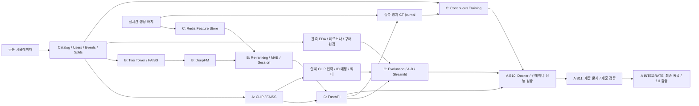

# 멀티모달 검색 및 Multi-Stage 추천 시스템

터미널 시연은 아래 명령을 사용한다. **터미널 1**에서 `docker compose up`으로 실행 로그를
보고, **같은 저장소 폴더의 터미널 2**에서 검색·추천·실험 명령을 입력한다.
`POST http://...`는 API 설명 표기이므로 쉘 명령처럼 입력하지 않는다.

```bash
# 최초 실행. 이미지가 없으면 빌드하고 full 데이터·모델을 준비한다.
docker compose up
# 소스를 수정하거나 새 버전을 pull한 직후에는 한 번 다시 빌드한다.
docker compose up --build
```

```bash
# 터미널 2: 실제 API JSON (PowerShell에서도 같은 명령)
docker compose exec api-server demo search --query-text "검정 오버핏 후드티"
docker compose exec api-server demo search --query-image data/full-v43/images/P000001.jpg
docker compose exec api-server demo search --query-text "가방" --query-image data/full-v43/images/P000001.jpg
docker compose exec api-server demo recommend --user-id U000001
# 실제 CT 모니터: 관측 표본이 없으면 미측정, 저하가 관측되면 알림
docker compose exec api-server demo ct
docker compose exec api-server demo ct --watch
```

A/B와 재학습은 별도 작업 컨테이너에서 순서대로 실행한다. API의 4GB 메모리에 모델을
추가 적재하지 않는다. 아래 A/B는 빠른 시연용 **100명/군·7일**이고 옵션 생략 시
config의 **5,000명/군·30일**을 실제 계산한다. 예시의 +28%나 p-value를 고정 출력하지 않는다.

```bash
docker compose run --rm --no-deps --pull never api-server demo ab --users-per-group 100 --days 7
# 별도 소규모 데이터에서 실제 학습·승격·롤백과 저하 알림을 확인
docker compose run --rm --no-deps --pull never api-server demo ct --drill --output docs/results/docker/ct_terminal_drill.json
```

운영 데이터의 지속 감시·임계치 재학습·API 모델 교체는 선택 CT worker로 실행한다.
API·대시보드를 포함해 Docker RAM 8GB 이상이 필요하며 A/B와 동시에 실행하지 않는다.
실제 신규 로그가 10,000건 이상이어야 학습하며, valid 개선이 부족하면 기존 모델을 유지한다.
신규 로그 수만으로 학습 가능 여부가 결정되지는 않는다. 새 시간순 train/valid 구간에
실제 노출·클릭·구매의 양성/음성 라벨이 없으면 `WAITING_FOR_LABELS`로 대기한다.
이때 기존 모델과 미처리 로그를 유지하며, 관측 데이터가 그대로이면 같은 스냅샷을 반복 생성하지 않는다.
일반 시뮬레이터의 미귀속 로그를 CTR/CVR 정답으로 바꾸지 않는다. 학습 전에는
`docker compose stop simulator`로 추가 생성을 멈추고 A/B와 순차 실행한다.

```bash
docker compose -f docker-compose.yml -f docker/compose.ct.yml --profile ct up --build ct
```

검색·추천은 JSON, A/B는 통계 표, CT는 알림이 기본 출력이다. `demo ab --json`,
`demo ct --json`은 기존 원본 JSON을 출력한다. `demo ct --watch --json --output <경로>`는
각 주기 결과를 즉시 출력·저장한다. A/B 원본은 현재 runtime 폴더의 `ab_test.json`,
CT CLI 원본은 `ct_cli.jsonl`이며, 준비 단계 상세 로그는 `logs/prepare-*.log`에 보존된다.
`docker compose exec api-server demo --help`로 명령을 확인한다.

기본 Compose 출력은 단계별 진행·완료·실패 위주다. 재시작 때 이미지를 자동으로 다시
빌드하지 않으며 Redis 정기 저장 메시지와 Streamlit 안내문은 기본 화면에서 제외한다.
Redis의 경고·오류와 API 오류는 계속 표시한다. Streamlit stdout은 컨테이너의
`/tmp/streamlit-stdout.log`, 서버 스레드·최적화 정보는 runtime의 `serving_runtime.json`에 남긴다.
첫 다운로드·데이터 생성·학습 시간과 Docker 자체의 진행 표시는 기기와 Compose 버전에 따라 다르다.

2026-11-10 수정본의 실행·품질·CT 확인 범위는
[수정 검증 기록](docs/results/experiments/A/final_fixes_20261110/report.md)을 따른다.
[PDF·동료 평가 통합 검증](docs/requirements_completion.md)과
[요구사항별 근거](docs/results/integration/20261107_requirements/requirements.json)는
2026-11-07 소스의 기록이며 현재 수정본의 전체 합격 판정으로 대체하지 않는다.
일상 실행은 `docker compose up`, 소스 변경 반영은 `docker compose up --build`이며
full 데이터와 모델을 컨테이너에서 준비한다.
기존 생성기 v4.2의 [2026-10-20 통합 기록](docs/results/integration/20261020_full/report.md),
[후속 Docker 기록](docs/results/experiments/A/docker_remove_replay_20261020.json),
그 이전 [체크리스트 기록](docs/results/experiments/A/workflow_checklist_fix_20261017.md)은 보존한다.
과거 PASS와 현재 데이터·소스의 새 측정을 구분한다.

팀장이 공통 개발 기반을 구현·검증해 `chore/shared-foundation` → main PR로 먼저 병합한 뒤,
세 사람이 독립 클론에서
Codex에 단계 실행만 지시해 검색·추천·서빙을 병렬 개발한다.

| 역할 | 이름 | 담당 | Codex 입력 |
|---|---|---|---|
| A(팀장) | 이제원 | 공통 준비, 검색, Docker·컨테이너 성능 검증, 제출 문서, 최종 통합 | `A 다음 단계 실행` |
| B | 박정욱 | Two Tower, DeepFM, 재랭킹, MAB, 세션 | `B 다음 단계 실행` |
| C | 박채영 | Redis, 서빙, 평가·대시보드, A/B, CT | `C 다음 단계 실행` |

C는 B9까지 플랫폼 PR을 완료·병합한다. A는 검색 `feat/A/search` 이후
Docker B10을 `feat/A/docker`, 제출 문서 B11을 `feat/A/submission`,
최종 통합을 `feat/integration`에서 순서대로 수행한다.
순서는 **C B9 → A B10 → A B11 → A INTEGRATE**이며, 각 의존성은 PR 병합된 main에서 가져온다.

첫 입력은 `B 개발환경 준비하고 다음 단계 실행`처럼 역할을 지정한다.
Codex가 setup·브랜치 준비·구현·검증·수정·로컬 commit을 수행하고 내용을 설명한다.
사용자가 확인해 푸시·PR 생성을 허가하면 Codex가 기능 브랜치를 push하고 main 대상 PR을
생성/갱신한다. 기능 완료 PR은 충돌·검증·CI·품질·필수 리뷰 조건을 확인해 자동 병합한다.
푸시는 설명·허가가 필요하며, 안전한 병합은 별도 확인 없이 수행한다. main 직접 푸시는 하지 않는다.
[사람이 따라 할 시작 가이드](docs/codex_quickstart.md),
[단계별 상세 요구사항](ai_step_prompts_optimized.md),
[병렬 작업·Git 계약](docs/team_workflow.md), [브랜치·PR 절차](docs/pr_workflow.md)를 참고한다.



환경을 직접 실행할 경우 한 명령으로 준비한다.

추천 정렬은 `config/recommend.yaml`의 `recommend.scoring.strategy`로 선택한다.
기본값 `ctr` 외에 `ctr_cvr`, `rank_fusion`, `similarity`, `newest`를 지원한다.
`similarity`는 ANN 후보 순위, `newest`는 등록일이 최신인 사용 가능한 상품을 우선한다.
최신순은 클릭 이력이 없는 사용자에게도 적용되며, MAB·신상품·카테고리 연속 제한은
후속 재정렬에서 유지된다. 따라서 최종 출력은 제약을 만족하는 최신순이며 단순 날짜 정렬과 다를 수 있다.
설정을 바꾼 뒤 서비스를 재시작한다. Docker에서는 설정이 이미지에 포함되므로
`docker compose up --build -d api-server`로 반영한다. 기본 정책의 품질 결과를 다른 전략의 결과로 사용하지 않는다.

기본 추천은 등록 7일 이내의 사용 가능한 신상품이 있으면 서빙 후보에 최소 1개를 확보한다.
구매 제외·등록 시점·후보 300개 상한을 지키며 별도로 측정하는 전체 카탈로그 ANN Recall@300은 바꾸지 않는다.
신상품이 없거나 다른 제약과 함께 충족할 수 없으면 진단을 남긴다. 7일 판정은 설정한 시뮬레이션 시각 기준이다.
빈 Docker 데이터 폴더의 첫 생성도 같은 파일시스템 안에서 임시 파일을 게시한다.

```bash
bash setup_env.sh . --role=B
# 선택: VS Code 대화 대신 CLI에서 다음 단계 실행
bash scripts/codex_run.sh B
```

기본 setup은 직접 의존성 설치, pip check, unit/contract 테스트, 시드42의 dev 데이터·이미지 생성,
시간 분할, train/valid 진단, 고정 CLIP revision 추론, Docker 상태/Compose 설정 검사를 수행한다.
Docker Desktop/Engine 실행·GitHub 인증·Codex 로그인은 각 컴퓨터의 선행 조건이다.
생략 옵션을 쓴 항목은 미측정이다. 실제 결과는 `.team/environment.json`과 docs/results에 저장한다.
데이터/.venv/캐시/모델은 커밋하지 않고 clone 후 동일하게 재생성한다.

검색·추천·Redis/API·평가·대시보드·CT 및 B10 Docker 구현이 main에 병합되어 있다.
모델 미준비 API는 503을 반환한다. B10 full 품질/지연과 B11 제출 문서 PR #13 병합을 확인했다.
현재 INTEGRATE 브랜치에서는 라이브 Redis MAB, 새 full Docker HTTP 성능과
valid 동결 후 test 품질 재검증을 통과했다. full A/B·CT 기능 검증도 완료했으며
최종 제출 판정은 [검사 원본](docs/results/integration/submission/checks.json)을 따른다.
최종 판정과 과거 실패는 [통합 기록](docs/results/integration/report.md)으로 구분한다.

```bash
source scripts/local_env.sh
./.venv/bin/python -m pytest -q tests
```

## Docker로 전체 서비스 실행

Docker Engine/Desktop와 Compose v2 이상을 실행한 뒤 저장소 루트에서 시작한다.
`docker-compose`는 별도 설치된 구형 CLI 이름이며 아래 절차는 `docker compose`를 사용한다.

```bash
git clone https://github.com/k-pang-2026/mm-recsys.git
cd mm-recsys
docker compose up
# 백그라운드 실행을 원하면 위 up 대신 다음을 사용한다.
docker compose up -d
docker compose logs -f api-server
```

기본 실행은 **full(상품 50,000·사용자 10,000·이벤트 1,000,000)** 이다.
기존 이미지는 재사용하며 소스 변경 후에는 `docker compose up --build`로 반영한다.
의존성 레이어와 호환 산출물은 재사용한다. 첫 이미지 빌드 진행은 Docker 자체 출력이다.

API만 준비 작업을 소유한다. 데이터 생성·검증 → 고정 revision의 CLIP 다운로드와 임베딩 →
FAISS 인덱스 → Two Tower·DeepFM·세션 학습 → Redis 프로필 warmup 순서다.
기존 데이터는 전체 manifest·이미지 checksum을 검사하고, 검색 산출물은 fingerprint와 checksum,
추천 산출물은 실제 모델 로딩으로 호환성을 확인한다. 완전한 호환 산출물만 재사용한다.
불완전하거나 다른 설정의 데이터·모델을 발견하면 보존하고 오류로 중단한다.
해당 파일을 삭제해 재시도하지 말고 새 버전의 data/model 경로를 설정한다.

한국어 준비 로그 뒤 실제 서비스 로딩 완료와 연결 상태를 출력한다. 예시에서 상품 수는
실제 카탈로그 크기이며 중복 벡터를 묶은 FAISS 내부 label 수와 구별한다.

```text
[api-server] FAISS 인덱스 로딩 완료 (50,000 상품)
[api-server] Two-Tower 모델 로딩 완료
[api-server] DeepFM Ranking 모델 로딩 완료
[api-server] http://localhost:8000 에서 검색·추천 API 서버 시작
[dashboard] 검색·추천 API 연결 완료
[dashboard] http://localhost:8501 에서 대시보드 시작
[simulator] API·대시보드 준비 완료; 행동 로그 생성 시작 (소량 모의 로그 생성·Redis 피처 갱신)
```

대시보드는 API `/ready`가 200이 된 뒤 시작하고, 시뮬레이터는 대시보드 HTTP health까지
통과한 뒤 소량의 새 모의 로그를 생성하고 Redis 실시간 피처를 갱신한다.
학습·평가용 100만 건은 준비 단계에서 생성하며, 전체 API 재전송이나 완주 대기는 없다.
컨테이너의 Started는 모델 준비 완료와 다르다.
첫 다운로드·데이터 생성·학습은 기기에 따라 오래 걸리며, 예시 로그의 초 단위 기동 시간을 보장하지 않는다.

| 서비스 | 로컬 주소 | 준비 상태 |
|---|---|---|
| 검색·추천 API | http://localhost:8000/docs | `/health`는 준비 중에도 200, `/ready`는 모델 로딩 완료 후 200 |
| Streamlit | http://localhost:8501 | HTTP health와 검색·추천 데모 제공 |
| Redis | localhost:6379 | ping healthcheck, 1GB 제한·allkeys-lru |
| 시뮬레이터 | 공개 포트 없음 | 준비 완료 후 소량 모의 로그 생성·Redis 피처 갱신 |

준비 중 모델 API와 `/ready`는 503이다. 준비 서버에서 실제 API로 전환하는 순간에는
연결이 잠시 끊길 수 있으므로 readiness 검사는 재시도한다. 준비 실패는 API 컨테이너 종료와
로그에 표시한다. 준비와 대기 기본 제한은 각각 21,600초이며
`PREPARE_TIMEOUT_SECONDS`, `READY_TIMEOUT_SECONDS`로 조절한다.
준비 완료 뒤 다음 smoke를 실행한다. 검색 JSON·multipart 3모드, 기존·신규 사용자 추천,
실제 이벤트에 따른 세션 응답, 대시보드 HTTP를 확인한다.

```bash
docker compose exec api-server python scripts/smoke_test.py --benchmark --output docs/results/docker/runtime-v43/full/quality/smoke_full.json
```

지연 검사는 각 모드 10회 warmup·100회 순차 HTTP, 후보 검색, 실제 Redis 조회의
p50/p95/p99와 원시 샘플을 기록한다. 검색/추천 200ms, 후보 100ms·300개, Redis 10ms 기준을
그대로 사용하며 미달 시 명령이 실패한다. 위 명령의 새 결과는 `docs/results/docker/runtime-v43/full/quality/smoke_full.json`과 같은 폴더의
`latency.json`에 남는다. 과거 결과 경로는 덮어쓰지 않는다. HTTP 확인은 실제 브라우저 화면 검증과 구별한다.
고정 벤치마크는 초기 v1.0과 CT 재학습이 동시에 실행되지 않는 조건을 대상으로 한다.
승격된 release나 측정 중 버전 변경은 거부하며 해당 release는 별도로 평가한다.
full A/B와 CT 전체 재학습은 순서대로 실행하고, 지연 측정 전에는 검증용 중복 배포와
학습 워커를 정리한다. 7.5GiB Docker 환경에서 두 full 배포·A/B·CT를 병렬 실행했을 때
검증용 API가 OOM/137로 종료된 기록은
[병렬 실행 근거](docs/results/integration/20261020_full/parallel_load_failure.json)에 보존했다.

학습·CT 로그와 새 평가는 `docs/results/docker/runtime-v43/<scale>/`에 분리한다.
Streamlit도 이 경로를 읽으며 새 통합 평가가 없으면 미측정으로 표시하고 데모는 제공한다.
저장소의 다른 머신 평가를 새 컨테이너의 측정으로 표시하지 않는다.
대시보드는 test 결과를 우선 선택한다. valid/test 품질 평가만 실행하면 종합 판정은
`UNMEASURED`이며, 시뮬레이터의 모의 로그 생성만으로 A/B·CT 통합 검사가 완료되지는 않는다.
현재 데이터의 full A/B, 실제 CT 재학습·교체/복구, 빈 클론 Compose 재현, HTTP·Redis·제출 검사를
모두 통과한 INTEGRATE 결과는 다음과 같이 검증 후 대시보드에 연결한다.
아래 경로는 2026-10-20 실행의 근거이며 새 실험에서는 해당 실험의 제출 결과 경로를 사용한다.

```bash
SCALE=full PYTHONHASHSEED=42 .venv/bin/python scripts/check_submission.py \
  --verify-existing --require-ready \
  --output-dir docs/results/integration/20261020_full/submission
SCALE=full PYTHONHASHSEED=42 .venv/bin/python scripts/publish_integration_dashboard.py \
  --submission docs/results/integration/20261020_full/submission/checks.json \
  --output docs/results/docker/runtime-v43/full/evaluation_full_test.json
```

발행 명령은 동결한 품질·지연 파일을 덮어쓰지 않는다. 소스, 데이터, 모델 또는 통합 근거가
달라지면 발행을 거부한다. 연결 후 http://localhost:8501 에서 **결과 새로고침**을 누르면
종합 판정, A/B 수치, 필수 통합 검사 근거를 확인할 수 있다. 새 품질 평가로 표시 파일을
갱신했다면 같은 검증·발행 절차를 다시 실행한다. 합성 A/B의 음의 lift와 CT의 기존 모델 유지도
그대로 공개하며, 기능 통합 통과와 실제 서비스 효과는 구분한다.

기존 C 평가 CLI로 기본 full/valid 결과를 생성할 때는 다음과 같이 실행한다.

```bash
docker compose exec -e CONFIG_PATH=models/full-v43/.docker/config.yaml api-server \
  python -m src.evaluation.run_all --split valid
```

Docker 기본 규모 full은 dev와 별도 경로 `data/full-v43`, `models/full-v43`을 사용한다.
로컬 Python의 `config.yaml` 기본값은 dev로 유지한다. 작은 데이터로 실행하려면 명시한다.

```bash
SCALE=dev docker compose up -d
SCALE=dev docker compose exec api-server python scripts/smoke_test.py --benchmark --output docs/results/docker/runtime-v43/full/quality/smoke_full.json
```

dev와 full을 함께 검증할 때는 별도 프로젝트·포트를 사용한다. B10 gate의
`mm-recsys-b10-full` 명령을 다시 실행하려면 다음과 같이 준비한다.

```bash
SCALE=full API_PORT=18000 DASHBOARD_PORT=18501 REDIS_PORT=16379 \
  docker compose -p mm-recsys-b10-full up --build -d
SCALE=full docker compose -p mm-recsys-b10-full exec api-server \
  python scripts/smoke_test.py --benchmark --output docs/results/docker/runtime-v43/full/quality/smoke_full.json
```

이 경우 API·Streamlit은 각각 localhost:18000·localhost:18501이다.

full 평가 CLI의 `CONFIG_PATH`는 `models/full-v43/.docker/config.yaml`이다.
모델 품질의 test 평가는 valid에서 선택·동결한 후 수행하며, smoke 성공만으로
full 품질이나 최종 제출 acceptance가 통과한 것으로 간주하지 않는다.
Docker 산출물에 C의 고정 평가 함수를 적용하고 Streamlit용 결과를 생성하는 B10 명령은 다음과 같다.
먼저 같은 규모의 `smoke_test.py --benchmark`가 통과해야 한다.

```bash
SCALE=full docker compose exec api-server python scripts/demo.py evaluate --split valid
SCALE=full docker compose exec api-server python scripts/demo.py evaluate --split test
SCALE=full docker compose exec api-server python -m docker.quality --split test --verify-existing
```

valid에서 데이터·모델·설정·평가 코드의 hash를 동결하고 test 전에 다시 검사한다.
품질 또는 지연 미달은 실패 종료한다. 원본 B/C 결과를 덮어쓰지 않고
`docs/results/docker/quality_full_{valid,test}.json`과 Docker runtime의 대시보드 파일을 만든다.
새 A/B 실험이 없으면 해당 탭은 미측정으로 유지한다. B11은 이 근거와 별도의 A/B·CT 근거를 집계한다.
오프라인 추천 품질은 B5 메모리 adapter를 사용한다. INTEGRATE는 Redis에
`arm_statistics`·`record_exposures`와 원자적 최대 보상·중복 방지·귀속 TTL을 연결했다.
[실제 full HTTP/별도 Redis 관측](docs/results/integration/mab_full.json)으로 연결을 검증했다.
[C의 인계 기록](docs/contributions/C.md)의 UNCONNECTED는 이전 측정 당시 상태이며,
오프라인 품질과 라이브 귀속 검증은 서로 다른 실행으로 구분한다.

CT 자동 재학습은 기본 네 서비스와 분리된 선택 profile이다. API의 loopback 네트워크를
공유하므로 C의 내부 reload 접근 제한을 유지한다.

```bash
docker compose -f docker-compose.yml -f docker/compose.ct.yml --profile ct up --build -d
```

시뮬레이터는 기존 페르소나·Markov 생성기로 기본 5초마다 100건의 새 모의 로그를 만든다.
한 묶음은 기존 사용자 한 명의 모의 행동이며, ID는 학습 데이터 및 다른 묶음과 구분한다.
로그는 `data/<scale>/stream/live/<데이터 fingerprint>/`에 별도로 보존하며,
설정된 모의 시각 `timestamp`와 실제 생성 시각 `generated_at`을 구분한다.
조회·장바구니·구매는 Redis의 기존 피처·보상 처리로 연결한다. 실패한 작은 묶음만
같은 ID로 재시도하며 처리 중인 파일은 성공 후 보관한다. 기존 100만 건 데이터와
평가·모델 파일을 다시 읽어 API로 전송하지 않는다. 재생 완료를 기다릴 필요가 없다.
이 모의 로그는 추천 노출에 귀속된 실제 사용자 반응이나 새 품질 측정의 근거가 아니다.
새 추천 반응 수집용 `/api/event`·`/api/feedback`과 선택 CT 워커는 그대로 제공한다.
CT는 충분한 귀속 반응이 없으면 품질을 미측정으로 유지하고,
재학습해도 validation 개선 조건을 충족해야 새 모델을 채택한다.

데이터·모델·결과는 호스트의 `data/`, `models/`, `docs/results/`에 유지한다.
Hugging Face 캐시와 Redis 상태는 named volume에 유지하므로 첫 다운로드에는 네트워크가
필요하고, 이후 동일 캐시를 재사용한다. `docker compose down`은 컨테이너만 중지·제거한다.
볼륨을 지우는 `down -v`는 별도 승인 없이 실행하지 않는다.

API 메모리는 4GB·CPU는 4개로 제한하고 Streamlit·시뮬레이터는 각각 512MB로 제한한다.
권장 호스트는 RAM 16GB·CPU 4코어·여유 디스크 50GB, Docker 메모리 8GB 이상이다.
선택 CT 학습은 API와 별도로 최대 4GB를 사용하므로 추가 메모리 여유가 필요하다.
CPU Torch 2.6.0·torchvision 0.21.0을 로컬과 이미지에 공통 사용한다.
`docker.serve:app`은 `src.search.api:app`을 그대로 사용하며 두 서비스 factory의 로딩이 끝난 뒤
학습 완료 후 새 API 프로세스가 numpy/Torch를 import하기 전에 CPU 라이브러리 초기 예산을 맞추고,
실제 추론 worker의 Torch·FAISS 스레드도 통일한다. 준비·학습 자식 프로세스의 기존 환경과 모델 가중치는 유지한다. 적용값은 runtime의 `serving_runtime.json`과 smoke에 기록한다.
Compose의 `SERVING_THREADS` 기본값은 valid에서 선택한 2다. 이를 지정하면 공유 추론
프로세스의 스레드만 바꿀 수 있으며 valid 요청으로 선택한다. Compose 밖에서는 미지정 시
`search.torch_threads`를 따른다. test 품질·정답·목표값을 바꾸지 않는다.
hybrid의 독립 텍스트·이미지 인코딩은 Docker adapter의 두 worker에서 병렬 실행한다.
기존 searcher 잠금으로 요청 간 인코딩을 직렬화하며 가중치·합성·검색은 원본을 사용한다.
어느 인코딩이 실패해도 둘 다 종료한 뒤 요청 이미지가 닫히도록 한다.
`SERVING_PARALLEL_HYBRID=0`으로 원래 순차 경로를 비교할 수 있다.
실제 CLIP valid 입력 12개의 벡터와 top10 비교는
[병렬 인코딩 검증](docs/results/docker/parallel_encoder_full.json)에 기록한다.
`SERVING_GC_FREEZE=1`은 모델 초기화 후 장수 객체를 반복 GC 스캔에서 분리한다.
임시 객체의 자동 GC는 유지하며 성공한 reload 뒤 수집·재등록하고 종료 시 해제한다.
full 진단에서 느린 요청 10개 모두 157~200ms의 세대 2 GC와 겹친 근거를 보존했다.
[Python의 freeze/unfreeze 정의](https://docs.python.org/3.11/library/gc.html#gc.freeze)를 사용하며
`SERVING_GC_FREEZE=0`으로 동일 조건의 진단을 재현할 수 있다.
`docker/constraints-*-py311-linux-arm64.txt`는 실제 Linux ARM64·Python 3.11 이미지에서
해결·검사한 의존성 제약이며 GPU 또는 다른 플랫폼에서 검증된 lock이 아니다.
다른 플랫폼은 해당 환경에서 다시 해결·검증해야 한다. Streamlit 이미지는 dashboard 의존성만
설치하며 torch·FAISS·transformers를 포함하지 않는다.

과거 B10 Linux ARM64 CPU의 full 초기 v1.0 측정(모드당 warmup 10회·순차 HTTP 100회)에서는
text/image/hybrid/recommendation p95가 각각 27.447/178.894/173.203/106.317ms였다.
후보 검색 p95는 4.967ms·최소 300개, Redis 조회 p95는 0.250ms였다.
모델·인덱스는 메모리에 로드하고 응답 캐시는 사용하지 않았으며 ONNX는 적용하지 않았다.
CT 동시 학습이 없는 조건의 결과이고 부하·머신별 보장은 아니다.
[full 원시 측정](docs/results/docker/smoke_full.json)과
[검증 결과](docs/results/docker/verified_full.json)를 참고한다.

최초 준비 시간은 CPU·캐시·산출물 존재 여부에 따라 달라진다. 실제 실행별 시간과 재사용 여부는
`docs/results/docker/runtime-v43/<scale>/preparation*.json`에 남는다. INTEGRATE는 별도 clone의 빈 data/models에서
full 데이터·임베딩·인덱스·세 모델 준비를 2,725.892초에 완료했다. 사전 학습 CLIP 다운로드 캐시와
의존성 레이어는 재사용했으며 이미지 빌드·API 최종 로딩·최초 네트워크 다운로드 시간과 구분한다.
[실제 cold 준비](docs/results/integration/preparation_first_full.json),
[두 번의 full 생성 비교](docs/results/integration/data_reproduction_full.json)를 보존한다.

이번 Linux ARM64 CPU 환경(Docker 약 7.5GiB, API 4GiB·4 CPU)에서 측정한 준비 시간은 다음과 같다.

| 규모 | 처음 추천 모델을 학습한 준비 | 호환 산출물을 재사용한 준비 | 첫 실행의 기존 산출물 |
|---|---:|---:|---|
| dev | 439.820초 | 21.342초 | 데이터·검색 재사용, 빈 HF 캐시 다운로드 포함 |
| full | 2,698.698초 | 77.544초 | 데이터·검색·HF 캐시 재사용 |

full 첫 준비에는 별도 dev 진단과 학습 일시정지 시간이 포함된다. 이 값은 새 클론 전체 생성이나
다른 머신의 예상 시간으로 사용하지 않는다. 원본은
[dev 준비](docs/results/experiments/A/docker_first_preparation_dev.json),
[full 준비](docs/results/experiments/A/docker_first_preparation_full.json)에 보존했다.
재사용 시간의 원본도 [dev](docs/results/docker/preparation_reuse_dev.json),
[full](docs/results/docker/preparation_reuse_full.json)에 별도로 보존했다.

PDF 기준과 분석: [공유 데이터·평가 계약](docs/contracts.md), [원본 문제 분석](docs/setup_analysis.md).
최종 제출 저장소: https://github.com/k-pang-2026/mm-recsys
GitHub 계정은 사용자 미제공이므로 자동으로 실명과 연결하거나 다른 사람의 커밋을 꾸미지 않는다.

## 제출 문서와 현재 상태

Python·PyTorch·transformers CLIP·FAISS CPU·FastAPI·Redis·Streamlit·Docker Compose를 사용한다.
주요 코드는 `src/common`(계약/설정), `src/simulator`(합성 데이터), `src/search`,
`src/recommendation`, `src/serving`, `src/evaluation`, `src/ct`에 있고,
`dashboard/`, `docker/`, `scripts/`, `tests/`, `docs/`가 실행·검증·보고서를 담는다.
직접 의존성은 requirements 파일, 공통 seed/규모/목표는 config YAML로 관리한다.

| 역할·이름 | 완료된 주요 기여 | 실제 병합 PR | GitHub handle |
|---|---|---|---|
| A 이제원 | 공통 기반·시뮬레이터·검색·워크플로·Docker·B11 제출 문서 | [#1](https://github.com/k-pang-2026/mm-recsys/pull/1), [#2](https://github.com/k-pang-2026/mm-recsys/pull/2), [#3](https://github.com/k-pang-2026/mm-recsys/pull/3), [#5](https://github.com/k-pang-2026/mm-recsys/pull/5), [#7](https://github.com/k-pang-2026/mm-recsys/pull/7), [#12](https://github.com/k-pang-2026/mm-recsys/pull/12), [#13](https://github.com/k-pang-2026/mm-recsys/pull/13) | 미등록 |
| B 박정욱 | Two Tower·ANN·DeepFM·재랭킹·MAB·세션 | [#4](https://github.com/k-pang-2026/mm-recsys/pull/4), [#8](https://github.com/k-pang-2026/mm-recsys/pull/8) | 미등록 |
| C 박채영 | Redis/API·A/B·평가·Streamlit·CT | [#6](https://github.com/k-pang-2026/mm-recsys/pull/6), [#9](https://github.com/k-pang-2026/mm-recsys/pull/9), [#10](https://github.com/k-pang-2026/mm-recsys/pull/10), [#11](https://github.com/k-pang-2026/mm-recsys/pull/11) | 미등록 |

담당 역할과 PR의 실제 head SHA는 [기여 근거](docs/submission/contributions.json)에 있다.
작성자 계정으로 개인 신원을 추측하지 않는다. B11 PR #13은 승인된 head로 병합했다.
INTEGRATE의 구현·실측은 현재 기능 브랜치에서 진행하며, 미래 원격 반영을 완료된 기여로 집계하지 않는다.

- [요구사항→파일→검사→실제 결과](docs/submission/requirements.md)
- [수식·baseline·full 품질·환경·제한](docs/submission/report.md)
- [A/B 통계와 음의 lift](docs/ab_test_report.md)
- [새 클론·Compose·curl·제출 검사 절차](docs/submission/reproduction.md)
- [제출 체크리스트와 INTEGRATE 인계](docs/submission/checklist.md)
- [설정/데이터/측정 identity snapshot](docs/submission/config_snapshot.json)
- [최종 acceptance 집계](docs/results/final_acceptance.json)

```bash
source scripts/local_env.sh
SCALE=full PYTHONHASHSEED=42 .venv/bin/python scripts/check_submission.py \
  --verify-existing --require-ready --output-dir docs/results/integration/20261020_full/submission
```

이 명령은 저장된 INTEGRATE 결과·소스·원시 지연·실행 근거를 재검증하며 새 모델 측정이 아니다.
최종 결과가 생성되기 전에는 미완료/누락으로 실패한다. 최종 판정은 `final_acceptance.json`을 따르며
구조 검증과 구분한다. 과거 B11 검사는 `final_submission/` 원본으로 보존했다.
이전 생성기 4.1 통합의 full valid/test 품질·A/B 통계 재검산·CT 기능 검증 기록은 보존한다.
이전 생성기 4.2의 종합 판정은 위 Docker 절차의 `20261020_full/submission` 검사 원본을 따른다.
P0는 사용자 전달 강사 결정에 따라 RESOLVED_OPTIONAL이며, 실제 데이터셋은 개발 후 추가 검증용이다.
[결정 원본](docs/submission/dataset_scope.json)과 [데이터 출처](docs/data_sources.md)를 확인한다.
원격 접근은 [확인 시각의 read-only snapshot](docs/results/final_submission/repository.json)이며,
과제 시스템에 URL을 제출하거나 공개 범위를 변경하는 작업은 수행하지 않았다.


## 이전 생성기 4.1 통합의 추론 실행 경로

기본 CPU API는 `SERVING_OPTIMIZE_VISION=1`로 같은 pinned FP32 CLIP vision graph를
시작 시 최적화한다. 전처리·가중치·합성·FAISS는 유지하며 응답 cache나 양자화는 사용하지 않는다.
입력 processor의 batch-one 3×224×224 경로를 사용하고 비표준 encoder 호출은 원본으로 처리한다.
`SERVING_OPTIMIZE_VISION=0`은 비교용 eager 경로이며 해당 경로의 최종 지연 통과를 보장하지 않는다.
query cache에는 구현·shape·실제 추론 시작 환경이 포함되고, Docker 품질 CLI도 같은 query 경로를 평가한다.
[valid 이미지/hybrid 400개](docs/results/integration/vision_parity_full_valid.json)의 top10은 모두 같았으며
최대 정규화 벡터 차이는 약 0.00000212였다. FP32 연산 재배치의 수치 오차이며 bit-exact라고 주장하지 않는다.

새 full HTTP p95는 text/image/hybrid/recommendation 36.767/123.496/118.009/54.323ms다.
각 모드 warmup 10회·100회 순차 호출이며 [원시 측정](docs/results/integration/smoke_full.json)과
[원시 표본 재검사](docs/results/integration/verified_full.json)를 보존한다.
최초 image/hybrid 220.594/225.821ms 및 graph만 적용한 hybrid 203.340ms 실패도
`docs/results/integration/attempts/`에 남겼다. 학습/CT/A-B 동시 부하에서의 p95 보장이 아니다.

generator 4.1.0은 생성에 영향을 주는 YAML mapping 순서를 fingerprint에 포함한다.
이전 4.0.0 데이터/모델은 보존하고 새 clone 또는 새 버전 경로를 사용한다.
이번 검증의 로컬 artifact 별칭은 [재현 문서](docs/submission/reproduction.md)를 따른다.
기본 새 clone의 `docker compose up --build`는 canonical config 경로에서 재생성한다.


현재 INTEGRATE 측정을 별도 경로에 기록하려면 동일한 full 프로젝트에서 다음을 사용한다.
`RUNTIME_RESULTS_DIR=docs/results/integration/runtime`으로 시작한 프로젝트의 예시이며,
기존 B10 결과를 새 측정으로 덮어쓰지 않는다.

```bash
SCALE=full RUNTIME_RESULTS_DIR=docs/results/integration/runtime docker compose exec api-server \
  python scripts/smoke_test.py --benchmark --output docs/results/integration/smoke_full.json
SCALE=full RUNTIME_RESULTS_DIR=docs/results/integration/runtime docker compose exec \
  -e QUALITY_RESULTS_DIR=docs/results/integration api-server python scripts/demo.py evaluate --split valid
SCALE=full RUNTIME_RESULTS_DIR=docs/results/integration/runtime docker compose exec \
  -e QUALITY_RESULTS_DIR=docs/results/integration api-server python scripts/demo.py evaluate --split test
```

실제 새 제출 검사는 `--output-dir docs/results/integration/submission`과
`--evidence-dir docs/results/integration --integration-checks docs/results/integration/checks.json`을 지정한다.
현재 머신의 19000 API와 보존된 이전 artifact 경로를 구분하는 환경은
[재현 절차](docs/submission/reproduction.md)를 따른다. 기본 B11 인수만으로 새 INTEGRATE를 집계하지 않는다.

### 이전 생성기 4.1 full A/B와 CT의 해석

full A/B는 5,000명/arm·30일이며 CTR 상대 lift −23.73%, CVR −37.18%였다.
합성 반응 가설에서 popularity 대조군보다 낮은 결과이며 실제 사용자 개선을 주장하지 않는다.
CT 자연 재학습은 valid CTR AUC 0.971602→0.971574로 RETAINED다.
별도 full 크기의 초기 상수 ranker 기능 시나리오에서 실제 승격·재로딩·롤백을 검증했다.
운영 v1.0과 재학습 후보 가중치는 보존했고, 두 결과는 [분리된 집계](docs/results/integration/ct_acceptance_full.json)에 있다.

## 한국어 CLI·실행 로그

Docker의 기본 진행 로그는 구성 요소·단계와 실제 수치 위주로 **stderr**에 출력한다.
`MM_LOG_FORMAT=detailed docker compose up`은 UTC 시각·상태를 포함한다(PowerShell은 환경 변수를 먼저 설정).
검색·추천 JSON은 **stdout**, `demo ab`는 통계 표, `demo ct`는 사람이 읽는 알림이 기본이다.
`demo ab --json`, `demo ct --json` 또는 원래 Python 모듈 실행은 원본 JSON을 사용한다.
API 키·옵션·파일명·모델 ID·지표명은 유지한다. 오류 원인·다음 조치와 원본 traceback을 보존한다.
`demo ct --watch --json`은 회차별 JSONL을 즉시 출력·저장한다.

서비스 준비 후 Bash에서 다음 명령을 실행한다. `--json`은 검색·추천·세션 CLI의 기본 출력
계약을 명시하며 한국어 설명은 계속 stderr로 나온다. `-T`는 두 스트림이 TTY에서 합쳐지지 않게 한다.

```bash
docker compose up --build
# 다른 터미널에서 실행. 아래 명령의 표준 출력은 원본 JSON, 표준 오류는 한국어 로그다.
docker compose exec -T api-server python scripts/demo.py search --query-text '검정 오버핏 후드티' --json > search.json 2> search.log
docker compose exec -T api-server python scripts/demo.py search --query-image data/full-v43/images/P000001.jpg --json > image.json 2> image.log
docker compose exec -T api-server python scripts/demo.py search --query-text '가방' --query-image data/full-v43/images/P000001.jpg --json > hybrid.json 2> hybrid.log
docker compose exec -T api-server python scripts/demo.py recommend --user-id U000001 --json > recommend.json 2> recommend.log
docker compose exec -T api-server python scripts/demo.py session --user-id cli-demo --product-id P000001 --category 'tote bag' --event-id cli-demo-click-1 --json > session.json 2> session.log
```

상품·사용자 ID와 카테고리는 현재 카탈로그에 맞춰 지정한다. 세션은 실제 `/api/event` 쓰기를
수행한다. 같은 클릭을 재시도할 때 `--event-id`를 유지하고, 새로운 클릭에는 새 ID를 지정한다.
새 추천 순서가 반드시 달라진다고 가정하지 않으며 `before`, `event_response`, `after`를 함께 반환한다.
호스트 실행은 `.venv/bin/python scripts/demo.py ... --api-url http://127.0.0.1:8000`을 사용한다.
추가 이미지 파일은 호스트 `data/demo/query.jpg`에 두면 컨테이너 `data/demo/query.jpg`로 접근할 수 있다.
`--output 경로.json`은 해당 CLI를 실행하는 호스트 또는 컨테이너에서 UTF-8 원본 결과를 저장한다.

A/B·평가·CT는 기존 명령을 사용한다. 아래는 full 기준이며 dev에서는 CONFIG_PATH의 `models/full-v43`을 `models/dev-v43`으로 바꾼다. 아래 A/B와 평가는 실제 계산을 실행하므로 메모리 여유를
확인하고 학습·지연 벤치마크와 동시에 실행하지 않는다. A/B 음의 변화와 유의하지 않은 결과도
그대로 출력하며, `null`은 수치를 계산할 근거가 부족함을 뜻한다.

```bash
docker compose run --rm --no-deps --pull never -T api-server demo ab --json --output docs/results/ab_console.json > ab.json 2> ab.log
docker compose exec -T -e CONFIG_PATH=/app/models/full-v43/.docker/config.yaml api-server python -m src.ct.retrain_trigger > ct.json 2> ct.log
# 재학습을 활성화할 때만 사용: 실제 누적 이벤트 임계치 충족 시 학습·검증·승격/유지 판정 실행
docker compose -f docker-compose.yml -f docker/compose.ct.yml --profile ct up --build ct
# 기존 valid 선택/동결 계약 유지. test를 튜닝에 사용하지 않는다.
docker compose run --rm --no-deps --pull never -T api-server demo evaluate --split valid > evaluation.json 2> evaluation.log
# 저장된 제출 근거 검사이며 새 full 품질 측정은 아니다. 현재 소스와 불일치하면 실패한다.
.venv/bin/python scripts/check_submission.py --verify-existing > peer.json 2> peer.log
```

Windows PowerShell에서는 먼저 터미널 입출력을 UTF-8로 지정한다. Windows PowerShell 5.1의
일반 `>`는 파일을 UTF-16로 저장할 수 있으므로, 아래처럼 `cmd`의 바이트 리디렉션을 사용한다
(Windows의 로컬 클론 디렉터리에서 실행). Python이 직접 저장하는 `--output` 파일은 UTF-8이다.

```powershell
$OutputEncoding = [Console]::OutputEncoding = [System.Text.UTF8Encoding]::new($false)
cmd /d /c 'docker compose exec -T api-server python scripts/demo.py search --query-text "검정 후드티" --json 1>search.json 2>search.log'
Get-Content -Encoding UTF8 search.json | ConvertFrom-Json
Get-Content -Encoding UTF8 search.log
# 이미지 빌드 후 PowerShell·컨테이너·저장 파일의 UTF-8 왕복 검사
powershell.exe -NoProfile -ExecutionPolicy Bypass -File scripts/verify_console_utf8.ps1
```

마지막 명령의 실행 정책은 해당 검사 프로세스에만 적용하며 시스템 정책을 변경하지 않는다.
검사 스크립트는 두 스트림을 UTF-8로 읽어 `.team/console-utf8/result.json`, `run.log`에 저장하고,
다시 읽은 한글과 인코딩을 비교한다. 실제 검증 범위와 명령은
[한국어 로그 검증 보고서](docs/cli_logging_validation.md)에 기록한다.

### PDF·동료 평가 통합 시연 (v4.3)

[실행·검증 안내](docs/requirements_completion.md)에 Bash·PowerShell 공통 명령과
검색·추천·세션·A/B·CT·평가·동료 평가 CLI를 정리했다. `scripts/demo.py --help`로 진입점을 확인한다.
Streamlit의 **EDA·구매 이력**, **상품·CLIP** 탭에서 실제 배포 데이터와 벡터를 확인할 수 있다.
브랜드충성형 생성 규칙을 수정하여 새 full 산출물은 `data/full-v43`, `models/full-v43`에 저장한다.
기존 v4.2 산출물은 보존한다. AUC 합격은 사용자 확인에 따라 CTR 기준이며 CVR은 별도로 보고한다.
이번 실행의 판정은 [요구사항별 근거](docs/results/integration/20261107_requirements/requirements.json)를 따른다.
