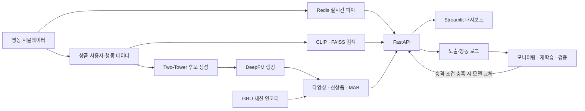

# 멀티모달 검색 및 Multi-Stage 추천 시스템

텍스트·이미지로 상품을 검색하고, 사용자 행동과 현재 세션을 반영해 상품을 추천하는 시스템입니다.
합성 고객 행동 데이터로 모델을 학습하며, 검색·추천 API, 평가 대시보드, A/B 실험과 자동 재학습을 로컬 Docker에서 실행합니다.

## PDF 요구사항 구현

| 요구사항 | 구현 방식 | 주요 코드 |
|---|---|---|
| 고객 행동 시뮬레이터 | 상품 50,000개·사용자 10,000명·행동 로그 1,000,000건, 6가지 페르소나, 3단계 카테고리와 Markov 전이 | [src/simulator](src/simulator/) |
| 멀티모달 검색 | CLIP 텍스트·이미지 임베딩과 FAISS HNSW로 텍스트·이미지·하이브리드 검색 제공 | [src/search](src/search/) |
| 후보 생성 | Two-Tower의 사용자·상품 임베딩을 이용해 전체 카탈로그에서 후보 300개 검색 | [candidate.py](src/recommendation/candidate.py) |
| 랭킹 | DeepFM으로 사용자·상품·교차·상황 피처를 학습하고 CTR/CVR 예측 | [deepfm.py](src/recommendation/deepfm.py) |
| 재랭킹 | 카테고리 연속 노출 제한, 신규 사용자 인기·트렌딩 폴백, 신상품 노출과 MAB 탐색 슬롯 | [reranking.py](src/recommendation/reranking.py) |
| 세션 추천 | GRU 세션 인코더의 단기 관심과 User Tower의 장기 선호 결합 | [session.py](src/recommendation/session.py) |
| API·실시간 피처 | FastAPI 검색·추천·행동 API와 Redis 기반 사용자 피처·탐색 보상 관리 | [src/serving](src/serving/) |
| 평가·A/B·대시보드 | 검색·추천 지표와 베이스라인 비교, 두 추천 전략의 CTR/CVR·p-value·95% 신뢰구간, Streamlit 시각화 | [src/evaluation](src/evaluation/), [dashboard](dashboard/) |
| Continuous Training | 활성 모델의 HitRate·CTR 저하 또는 신규 로그 10,000건 누적 시 재학습, 검증 후 모델 승격·유지 및 버전·롤백 관리 | [src/ct](src/ct/) |

데이터는 seed 42로 생성하고 시간순 train/valid/test = 80/10/10으로 나눕니다.
모델 선택은 valid에서 수행하며 test는 최종 평가에 사용합니다.
규모·페르소나·학습 설정은 [config.yaml](config.yaml), 검색·추천·서빙 설정은 [config/](config/)에서 관리합니다.
지표 정의와 평가 조건은 [평가 계약](docs/contracts.md), 측정 결과는 [실험 보고서](docs/submission/report.md)를 참고하세요.



## 팀원 역할 분담

| 팀원 | 역할 | 담당 범위 |
|---|---|---|
| 이제원 | A · 팀장 | 공통 기반·시뮬레이터, CLIP/FAISS 검색, Docker 배포·성능 검증, 제출 문서·최종 통합 |
| 박정욱 | B · 추천 | Two-Tower, DeepFM, 재랭킹·MAB, 세션 기반 추천 |
| 박채영 | C · 플랫폼 | Redis Feature Store, API 서빙, 평가·A/B, Streamlit 대시보드, CT 파이프라인 |

작업별 기여와 변경 내역은 [닫힌 Pull Request](https://github.com/k-pang-2026/mm-recsys/pulls?q=is%3Apr+is%3Aclosed)에서 확인할 수 있습니다.

## Docker로 로컬 결과 확인

### 1. 서비스 실행

Docker Desktop 또는 Docker Engine과 Compose v2 이상이 필요합니다.
CPU 실행을 지원하며, PDF 기준 환경은 RAM 16GB·CPU 4코어·여유 디스크 50GB·Docker 메모리 8GB 이상입니다.
Windows에서는 Docker Desktop을 실행하고 WSL을 사용하는 경우 해당 배포판의 WSL Integration을 켭니다.

```bash
git clone https://github.com/k-pang-2026/mm-recsys.git
cd mm-recsys
docker compose up --build
```

처음에는 full 데이터 생성, CLIP 다운로드·임베딩, 검색 인덱스 구축과 추천 모델 학습을 자동으로 진행합니다.
첫 준비에는 인터넷 연결과 학습 시간이 필요합니다. 이후 같은 설정으로 실행하면 준비된 산출물을 재사용합니다.
일반 재실행은 `docker compose up`, 백그라운드 실행은 `docker compose up -d`를 사용합니다.

같은 저장소의 다른 터미널에서 상태를 확인합니다.

```bash
docker compose ps
docker compose logs --tail=50 api-server
curl --fail http://localhost:8000/ready
```

`/ready`가 `{"status":"ready"}`를 반환하면 시연을 시작할 수 있습니다.

| 확인할 내용 | 주소 |
|---|---|
| 검색·추천·평가 대시보드 | http://localhost:8501 |
| API 문서와 요청 실행 | http://localhost:8000/docs |
| 모델 준비 상태 | http://localhost:8000/ready |

대시보드에서 검색·추천을 직접 실행하고, EDA·구매 이력 및 상품·CLIP 탭에서 데이터를 확인할 수 있습니다.

### 2. PDF 결과 예시 전체 시연

다음 명령은 **검색 → 클릭 두 건과 세션 추천 → A/B 실험 → CT 학습·승격·롤백 시연**을 순서대로 실행합니다.

```bash
docker compose run --rm --no-deps --pull never api-server demo examples
```

A/B 기본 규모는 5,000명/군·30일입니다. 빠르게 동작을 확인하려면 다음을 사용합니다.

```bash
docker compose run --rm --no-deps --pull never api-server demo examples --users-per-group 100 --days 7
```

CT 시연은 별도 소규모 데이터와 모델로 실행합니다. 운영 자동 CT는 실제 누적 로그를 사용하며,
라벨이 부족하면 대기하고 후보가 검증 기준을 충족할 때 모델을 교체합니다.
PDF 10~12페이지의 숫자는 참고 예시이며, 출력에는 실제 상품·점수·통계가 표시됩니다.

Linux/WSL/macOS에서는 Python 3.10 이상으로 아래 명령을 한 번 실행하면 `demo`로 줄여 사용할 수 있습니다.

```bash
python3 scripts/demo_host.py --install
# 등록기가 PATH 설정을 안내하면 해당 명령을 적용한 뒤 실행합니다.
demo examples
```

Windows에서는 `python scripts/demo_host.py examples`를 사용하거나 위 Docker 명령을 그대로 실행합니다.

### 3. 기능별 시연과 CT 상태 확인

```bash
# 텍스트·이미지·하이브리드 검색
docker compose exec -T api-server demo search --query-text "검정 오버핏 후드티"
docker compose exec -T api-server demo search --query-image data/full-v44/images/P000001.jpg
docker compose exec -T api-server demo search --query-text "가방" --query-image data/full-v44/images/P000001.jpg

# 개인화 추천과 실제 CT 모니터링 결과
docker compose exec -T api-server demo recommend --user-id U000001
docker compose exec -T api-server demo ct

# 빠른 A/B 실험 또는 별도 CT 시연
docker compose run --rm --no-deps --pull never api-server demo ab --users-per-group 100 --days 7
docker compose run --rm --no-deps --pull never api-server demo ct --drill
```

기본 simulator는 로그 수집과 자동 CT를 함께 실행합니다.
재학습에는 관측 시간이 지난 충분한 노출·행동 라벨이 필요합니다. `config/serving.yaml`에서
성능 저하 트리거와 재시도 간격(기본 300초)을 설정하며, 같은 입력으로 학습을 반복하지 않습니다.
`docker compose logs -f simulator`에서 누적 로그·재학습 진행·모델 승격 또는 유지 결과를 확인합니다.
A/B와 CT 학습은 공유 잠금으로 순차 실행하므로, 다른 학습이 진행 중이면 기다릴 수 있습니다.

### 4. 품질 지표 확인

새 실행 환경의 품질 지표는 평가 후 대시보드에 표시됩니다.
초기 모델의 지연·품질을 측정할 때는 진행 중인 학습이 끝난 뒤 simulator를 멈추고 다음 순서로 실행합니다.

```bash
docker compose stop simulator
docker compose exec -T api-server python scripts/smoke_test.py --benchmark --output docs/results/docker/runtime-v44/full/quality/smoke_full.json
docker compose run --rm --no-deps --pull never api-server demo evaluate --split valid
docker compose run --rm --no-deps --pull never api-server demo evaluate --split test
docker compose start simulator
```

valid 평가가 통과한 후 test를 실행합니다. 대시보드에서 **결과 새로고침**을 누르고 `evaluation_full_test.json`을 선택합니다.
지연은 10회 준비 호출 후 100회 단건 요청의 p95로 측정합니다.
이 평가는 검색·추천 품질을 확인하며, 최종 종합 판정은 별도 통합 검증 결과를 사용합니다.

### 5. 결과 저장과 종료

데이터는 `data/`, 모델은 `models/`, 실행 결과는 `docs/results/docker/runtime-v44/full/`에 저장됩니다.
전체 시연 결과는 그 아래 `pdf-examples/<실행ID>/`, 품질 평가 원본은 `quality/`에서 확인합니다.
데이터·모델·실행 결과는 호스트에 남고, Redis 상태와 모델 다운로드 캐시는 Docker 볼륨에 보존됩니다.

```bash
# 전체 서비스 종료
docker compose down

# 다시 실행
docker compose up -d
```
