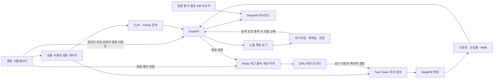

# 멀티모달 검색 및 Multi-Stage 추천 시스템

텍스트·이미지로 상품을 검색하고, 사용자 행동과 현재 세션을 반영해 상품을 추천하는 시스템입니다.
합성 고객 행동 데이터로 모델을 학습하며, 검색·추천 API, 평가 대시보드, A/B 실험과 자동 재학습을 로컬 Docker에서 실행합니다.

**최신 평가 대시보드 (2026-11-23 개편): https://kpang-mm-recsys.streamlit.app**

| 보는 곳 | 주소 | 화면 |
|---|---|---|
| 온라인 (설치 없이 바로) | https://kpang-mm-recsys.streamlit.app | 11/23 개편 화면 · 저장된 평가 결과(`docs/results`)를 보여 주는 읽기 전용 |
| 로컬 Docker (PDF 2쪽 실행 주소) | http://localhost:8501 | 같은 11/23 개편 화면 · 「직접 해보기」 검색·추천과 실시간 API 상태 포함 |

두 주소 모두 지금 main의 대시보드입니다. 한 페이지에 개요부터 참고까지 이어지고, 왼쪽 목차가 지금 읽는 곳을 따라 펼쳐집니다. 기본으로 보여 주는 기록은 새 도안(`illustrations-v1`) 카탈로그의 2026-11-21 full test(「최종 제출 · 시험 데이터」)이며, 개요 › 측정 기록에서 「상품 그림 바꾸기 전」 등 비교용 기록도 고를 수 있습니다.
로컬 실행은 [Docker로 로컬 결과 확인](#docker로-로컬-결과-확인)을 따릅니다. 온라인 앱은 무료라 한동안 접속이 없으면 잠들며, 화면의 깨우기 버튼을 누르면 1분 안팎으로 다시 열립니다. 배포 원본은 `giitbal/mm-recsys` 포크의 `feat/dashboard-redesign` 브랜치입니다.

PDF 2·4·7절의 로컬 통합 검증을 통과했습니다. 전체 성능 기준 11개와 후보 300개 조건을 충족했습니다. 제출 소스와 통합 PR의 병합 내역은 공개 저장소에서 확인할 수 있습니다. [공개 저장소](https://github.com/k-pang-2026/mm-recsys) · [제출 보고서](docs/submission/report.md) · [최종 검사 결과](docs/results/final_acceptance.json)

검색 600개 질의의 모드별 점수와 BM25 비교, 추천 1만 명의 성능과 기준선, 5,000명씩 30일간 비교한 합성 실험의 CTR·CVR을 각각 확인할 수 있습니다. [검색 보고서](docs/search_report.md) · [추천 보고서](docs/recommend_report.md) · [A/B 보고서](docs/ab_test_report.md) · [재현 절차](docs/submission/reproduction.md)

## PDF 요구사항 구현

| 요구사항 | 구현 방식 | 주요 코드 |
|---|---|---|
| 고객 행동 시뮬레이터 | 상품 50,000개·사용자 10,000명·행동 로그 1,000,000건, 6가지 페르소나, 3단계 카테고리와 Markov 전이 | [src/simulator](src/simulator/) |
| 멀티모달 검색 | CLIP 텍스트·이미지 임베딩과 FAISS HNSW로 텍스트·이미지·하이브리드 검색 제공 | [src/search](src/search/) |
| 후보 생성 | Two-Tower의 사용자·상품 임베딩을 이용해 전체 카탈로그에서 후보 300개 검색 | [candidate.py](src/recommendation/candidate.py) |
| 랭킹 | DeepFM으로 사용자·상품·교차·상황 피처를 학습하고 CTR/CVR 예측 | [deepfm.py](src/recommendation/deepfm.py) |
| 재랭킹 | 카테고리 연속 노출 제한, 신규 사용자 인기·트렌딩 폴백, 신상품 노출과 MAB 탐색 슬롯 | [reranking.py](src/recommendation/reranking.py) |
| 세션 추천 | GRU 세션 인코더의 단기 관심과 User Tower의 장기 선호 결합 | [session.py](src/recommendation/session.py) |
| API·실시간 피처 | FastAPI 검색·추천·행동 API와 Redis 기반 사용자 피처·탐색 보상 관리 | [src/serving](src/serving/) |
| 평가·A/B·대시보드 | 검색·추천 지표와 베이스라인 비교, 두 추천 전략의 CTR/CVR·p-value·95% 신뢰구간, Streamlit 시각화 | [src/evaluation](src/evaluation/), [dashboard](dashboard/) |
| Continuous Training | 활성 모델의 HitRate·CTR 저하 또는 신규 로그 10,000건 누적 시 재학습, 검증 후 모델 승격·유지 및 버전·롤백 관리 | [src/ct](src/ct/) |

데이터는 seed 42로 생성하고 시간순 train/valid/test = 80/10/10으로 나눕니다.
모델 선택은 valid에서 수행하며 test는 최종 평가에 사용합니다.
규모·페르소나·학습 설정은 [config.yaml](config.yaml), 검색·추천·서빙 설정은 [config/](config/)에서 관리합니다.
지표 정의와 평가 조건은 [평가 계약](docs/contracts.md), 측정 결과는 [실험 보고서](docs/submission/report.md)를 참고하세요.

## 시스템 아키텍처



## 팀원 역할 분담

| 팀원 | 역할 | 담당 범위 |
|---|---|---|
| 이제원 | A · 팀장 | 공통 기반·시뮬레이터, CLIP/FAISS 검색, Docker 배포·성능 검증, 제출 문서·최종 통합 |
| 박정욱 | B · 추천 | Two-Tower, DeepFM, 재랭킹·MAB, 세션 기반 추천 |
| 박채영 | C · 플랫폼 | Redis Feature Store, API 서빙, 평가·A/B, Streamlit 대시보드, CT 파이프라인 |

담당 모듈과 단계별 작업 기록을 팀원별로 확인할 수 있습니다. [이제원 기여](docs/contributions/A.md) · [박정욱 기여](docs/contributions/B.md) · [박채영 기여](docs/contributions/C.md) · [닫힌 Pull Request](https://github.com/k-pang-2026/mm-recsys/pulls?q=is%3Apr+is%3Aclosed)

## Docker로 로컬 결과 확인

### 1. 서비스 실행

Docker Desktop 또는 Docker Engine과 Compose v2 이상이 필요합니다.
CPU 실행을 지원하며, PDF 기준 환경은 RAM 16GB·CPU 4코어·여유 디스크 50GB·Docker 메모리 8GB 이상입니다.
Windows에서는 Docker Desktop을 실행하고 WSL을 사용하는 경우 해당 배포판의 WSL Integration을 켭니다.

```bash
git clone https://github.com/k-pang-2026/mm-recsys.git
cd mm-recsys
docker compose up --build
```

처음에는 full 데이터 생성, CLIP 다운로드·임베딩, 검색 인덱스 구축과 추천 모델 학습을 자동으로 진행합니다.
첫 준비에는 인터넷 연결과 학습 시간이 필요합니다. 이후 같은 설정으로 실행하면 준비된 산출물을 재사용합니다.
일반 재실행은 `docker compose up`, 백그라운드 실행은 `docker compose up -d`를 사용합니다.

같은 저장소의 다른 터미널에서 상태를 확인합니다.

```bash
docker compose ps
docker compose logs --tail=50 api-server
curl --fail http://localhost:8000/ready
```

`/ready`가 `{"status":"ready"}`를 반환하면 아래 요청으로 시연할 수 있습니다. 두 요청 모두 반환 개수의 기본값은 10입니다. 이미지 검색은 같은 검색 경로에 Base64 문자열 `query_image`를 보내고, 복합 검색은 `query_text`와 `query_image`를 함께 보냅니다.

```bash
curl --fail -H 'Content-Type: application/json' -d '{"query_text":"검정 오버핏 후드티"}' http://localhost:8000/api/search
curl --fail 'http://localhost:8000/api/recommend?user_id=U000001'
```

| 확인할 내용 | 주소 |
|---|---|
| Streamlit 평가 대시보드 (기본 · 11/23 개편 화면) | http://localhost:8501 |
| API 문서와 요청 실행 | http://localhost:8000/docs |
| 모델 준비 상태 | http://localhost:8000/ready |
| 대시보드 카탈로그를 공유하는 쇼핑몰 | http://localhost:3000 · http://localhost:3000/operations |

대시보드의 「직접 해보기」에서 검색·추천을 실행하고 상품·CLIP 벡터와 구매 원장을 조회하며, 「데이터」에서 EDA·페르소나를 확인할 수 있습니다.

기본 대시보드·API·쇼핑몰은 같은 `illustrations-v1` 카탈로그와 CLIP 인덱스를 사용합니다. full 상품 5만 개의 JPEG와 독립 검색 평가 쿼리를 새 생성기로 그립니다. 모델 준비 중에는 같은 데이터의 full test와 합성 A/B 기준 측정을 표시합니다. 「A/B 실험」에 실제 군별 인원과 기간이 표시됩니다.

쇼핑몰을 추가로 실행하려면 저장소 루트에서 다음 명령을 실행하세요.

```bash
docker compose --profile storefront up -d --build --no-deps storefront
```

기본 시스템이 꺼져 있다면 `docker compose --profile storefront up -d --build storefront` 한 번으로 Redis·API·쇼핑몰을 시작할 수 있습니다.

쇼핑몰은 시뮬레이터 상품 조회, 검색, 추천, 장바구니와 데모 구매를 실제 API에 연결합니다. 쇼핑몰만 멈추려면 `docker compose stop storefront`, 선택 서비스까지 모두 종료하려면 `docker compose --profile storefront down`을 실행하세요. [쇼핑몰 안내](storefront/README.md)

### 2. PDF 결과 예시 전체 시연

다음 명령은 **검색 → 클릭 두 건과 세션 추천 → A/B 실험 → CT 학습·승격·롤백 시연**을 순서대로 실행합니다.

```bash
docker compose run --rm --no-deps --pull never api-server demo examples
```

A/B 기본 규모는 5,000명/군·30일입니다. 빠르게 동작을 확인하려면 다음을 사용합니다.

```bash
docker compose run --rm --no-deps --pull never api-server demo examples --users-per-group 100 --days 7
```

CT 시연은 별도 소규모 데이터와 모델로 실행합니다. 운영 자동 CT는 실제 누적 로그를 사용하며,
라벨이 부족하면 대기하고 후보가 검증 기준을 충족할 때 모델을 교체합니다.
PDF 10~12페이지의 숫자는 참고 예시이며, 출력에는 실제 상품·점수·통계가 표시됩니다.

Linux/WSL/macOS에서는 Python 3.10 이상으로 아래 명령을 한 번 실행하면 `demo`로 줄여 사용할 수 있습니다.

```bash
python3 scripts/demo_host.py --install
# 등록기가 PATH 설정을 안내하면 해당 명령을 적용한 뒤 실행합니다.
demo examples
```

Windows에서는 `python scripts/demo_host.py examples`를 사용하거나 위 Docker 명령을 그대로 실행합니다.

### 3. 기능별 시연과 CT 상태 확인

```bash
# 텍스트·이미지·하이브리드 검색
docker compose exec -T api-server demo search --query-text "검정 오버핏 후드티"
docker compose exec -T api-server demo search --query-image data/full-illustrations-v1/images/P000001.jpg
docker compose exec -T api-server demo search --query-text "가방" --query-image data/full-illustrations-v1/images/P000001.jpg

# 개인화 추천과 실제 CT 모니터링 결과
docker compose exec -T api-server demo recommend --user-id U000001
docker compose exec -T api-server demo ct

# 빠른 A/B 실험 또는 별도 CT 시연
docker compose run --rm --no-deps --pull never api-server demo ab --users-per-group 100 --days 7
docker compose run --rm --no-deps --pull never api-server demo ct --drill
```

기본 simulator는 로그 수집과 자동 CT를 함께 실행합니다.
재학습에는 관측 시간이 지난 충분한 노출·행동 라벨이 필요합니다. `config/serving.yaml`에서
성능 저하 트리거와 재시도 간격(기본 300초)을 설정하며, 같은 입력으로 학습을 반복하지 않습니다.
`docker compose logs -f simulator`에서 누적 로그·재학습 진행·모델 승격 또는 유지 결과를 확인합니다.
A/B와 CT 학습은 공유 잠금으로 순차 실행하므로, 다른 학습이 진행 중이면 기다릴 수 있습니다.

### 4. 품질 지표 확인

현재 환경에서 직접 측정하려면 아래 순서로 실행하세요. 완료된 실행 경로의 평가 파일이 제출 기준 보고서보다 먼저 선택됩니다.
초기 모델의 지연·품질을 측정할 때는 진행 중인 학습이 끝난 뒤 simulator를 멈추고 다음 순서로 실행합니다.

```bash
docker compose stop simulator
docker compose exec -T api-server python scripts/smoke_test.py --benchmark --output docs/results/docker/runtime-illustrations-v1/full/quality/smoke_full.json
docker compose run --rm --no-deps --pull never api-server demo evaluate --split valid
docker compose run --rm --no-deps --pull never api-server demo evaluate --split test
docker compose start simulator
```

valid 평가가 통과한 후 test를 실행합니다. 대시보드 개요 › 측정 기록에서 **기록 다시 읽기**를 누르고 「이 컴퓨터에서 실행 (전체 데이터)」와 「시험 데이터」(`evaluation_full_test.json`)를 고릅니다.
지연은 10회 준비 호출 후 100회 단건 요청의 p95로 측정합니다.
이 평가는 검색·추천 품질을 확인하며, 최종 종합 판정은 별도 통합 검증 결과를 사용합니다.

### 5. 결과 저장과 종료

데이터는 `data/`, 모델은 `models/`, 실행 결과는 `docs/results/docker/runtime-illustrations-v1/full/`에 저장됩니다.
전체 시연 결과는 그 아래 `pdf-examples/<실행ID>/`, 품질 평가 원본은 `quality/`에서 확인합니다.
데이터·모델·실행 결과는 호스트에 남고, Redis 상태와 모델 다운로드 캐시는 Docker 볼륨에 보존됩니다.

```bash
# 선택 실행한 쇼핑몰까지 종료
docker compose --profile storefront down

# 다시 실행
docker compose up -d
```

## 실제 데이터셋 추가 검증

H&M 구매 추천·시뮬레이터 교정, Retailrocket Markov 전이 추정, DeepFashion CLIP 검증은
[실제 데이터 활용·재현 절차](docs/external_datasets.md)를 따른다. 원자료는 `학습 데이터셋 추천/`에 두며
기존 합성 full 결과와 별도 경로에서 실행한다. 고객·이미지 표본 실험을 전체 데이터 품질로 해석하지 않는다.

**기존 도안으로 측정한 교정 full 결과 (2026-11-15).** PDF의 실제 데이터 활용 목적에 맞춰 H&M의
카테고리·상대 거래가격, Retailrocket의 Markov 전이·활동량·행동 간격을 시뮬레이터에
반영했다. DeepFashion은 고정 CLIP의 실제 의류 사진 표현 품질 검증에 사용했다.
가격·활동량 집중도·행동 간격의 분포 오차가 줄었으며, 세션 길이·반복 구매에는 차이가 남는다.

동결한 교정 레시피로 상품 5만·사용자 1만·이벤트 100만 건을 새로 생성하고
Two-Tower·DeepFM·GRU 및 CLIP 임베딩·FAISS 인덱스를 준비했다.
교정 full test의 품질·지연 기준 **11/11 통과**, 회귀 테스트 **519개 통과**다.
이는 추천 효과 향상이나 PDF 전체 최종 합격을 뜻하지 않는다. CVR AUC는 0.5052이며,
500명/군×7일 합성 A/B는 인기순 대비 CTR −39.56%, CVR −54.90%였다.
자연 운영 CT 승격과 제출 문서 정합성 문제는 별도 미완료 항목으로 보존한다.

[현실성 개선 내용과 한계](docs/external_datasets.md#교정-레시피의-full-통합-검증--2026-11-15) ·
[full 측정 보고서](docs/results/experiments/A/realism_full_20261115/report.md) ·
[별도 Docker 실행 명령](docs/results/experiments/A/realism_full_20261115/README.md)

현재 `config/full_realism_v4.yaml`과 `docker/compose.realism-full.yaml`은 새 도안으로 교정 카탈로그를 생성한다. 새 교정 실험은 별도 출력 경로에 기록한다. 원본 데이터·이미지·임베딩·모델은 저장소에 포함하지 않는다.
